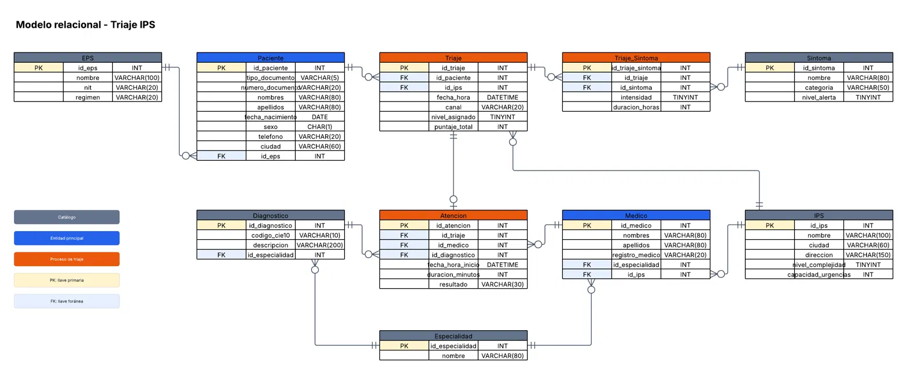
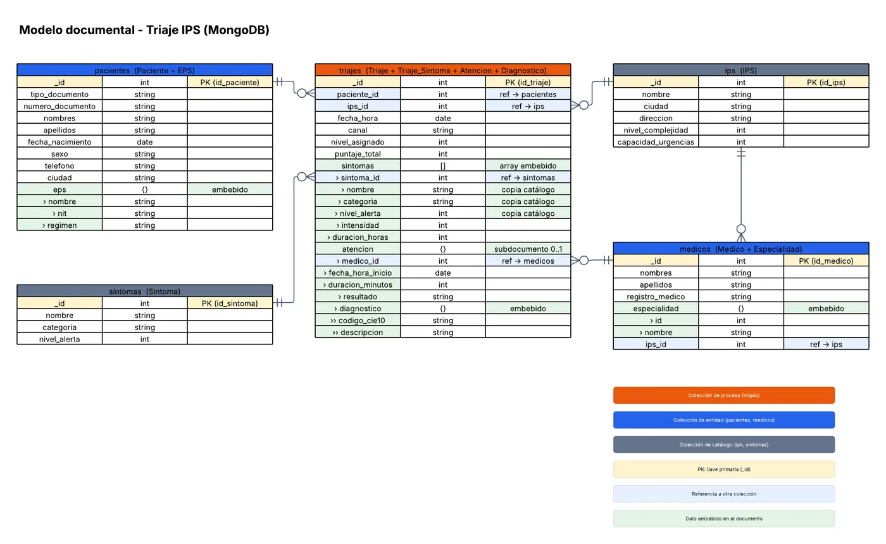

# Proyecto-triaje

Taller evaluativo 3 de Bases de Datos II: migración de una base de datos
relacional en SQL Server a un modelo documental en MongoDB.

**Caso de estudio:** sistema de pre-triaje de síntomas para IPS. El paciente
reporta sus síntomas, se calcula un puntaje y se asigna un nivel de atención
(normal, media o urgente). Los datos son sintéticos.

**Autores:** Samuel Buitrago Bermudez e Isaac Tamayo

## Estructura

| Carpeta | Contenido |
|---|---|
| `sql/` | Script de creación de las 10 tablas y script que genera y carga los 5.500 registros |
| `migracion/` | Script que migra los datos de SQL Server a MongoDB y verifica la migración |
| `consultas/` | 8 aggregation pipelines sobre la colección `triajes` |
| `modelos/` | Modelo relacional y modelo documental |

## Requisitos

- SQL Server y SSMS (o Azure Data Studio)
- MongoDB y Compass
- Python 3.9 o superior
- ODBC Driver 17 o 18 para SQL Server
- Dependencias de Python: `pip install -r requirements.txt`

## Cómo ejecutarlo

1. Ejecutar `sql/01_crear_tablas.sql` en SQL Server (crea la base `TriajeIPS`).
2. Ajustar la conexión en las primeras líneas de `sql/02_poblar_datos.py` y ejecutar
   `python sql/02_poblar_datos.py` (carga 5.500 registros en 10 tablas).
3. Ajustar la conexión en las primeras líneas de `migracion/03_migrar_a_mongo.py` y ejecutar
   `python migracion/03_migrar_a_mongo.py` (crea la base `TriajeIPS_mongo` con 5 colecciones
   y muestra la verificación).
4. Ejecutar las consultas de `consultas/04_consultas.js` en la pestaña
   Aggregations de Compass (colección `triajes`) o en mongosh.

## Modelos

